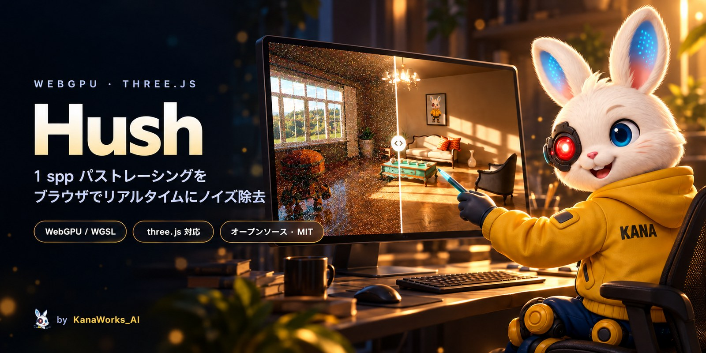

<div align="center">



<p>
  <a href="LICENSE"></a>
  
  <a href="https://threejs.org"></a>
  
  <a href="https://hush.tokyoaivisuals.club"></a>
  <a href="https://github.com/kanaworksai-hue/hush/stargazers"></a>
</p>

<p><a href="https://github.com/kanaworksai-hue"></a>&nbsp;<a href="https://github.com/kanaworksai-hue"><b>KanaWorks_AI のプロジェクト</b></a></p>

[English](README.md) | [简体中文](README.zh-CN.md) | **日本語**

[🖥️ ライブデモ](https://hush.tokyoaivisuals.club) · [three.js サンプル](https://hush.tokyoaivisuals.club/examples/three/) · [クイックスタート](#-クイックスタート) · [API](#-api) · [制限事項](#%EF%B8%8F-制限事項) · [⭐ Star](#-気に入ったら-star-を)

</div>

**Hush** は、1 ピクセルあたり 1 サンプル（1 spp）のノイズだらけのパストレーシング画像を、ブラウザ上でリアルタイムに、時間的にも安定したきれいな画像に変えます。お使いの `GPUDevice` 上で動く数個の WebGPU compute パスで、ノイズ画像と G-buffer（法線・深度・アルベド・モーションベクトル）を `GPUTexture` として渡すと、ノイズ除去済みのテクスチャが返ってきます。three.js の `WebGPURenderer` でも、ほかの WebGPU レンダラーでも使えます。

<p align="center">
  
  <br><sub>同じフレームで、左が 1 ピクセル 1 サンプル、右が Hush をかけた結果です。</sub>
</p>

## ✨ 特長

<table>
<tr>
<td align="center" width="25%"><b>⚡ リアルタイム</b><br><sub>1 フレームあたり数パス。ネットワークは半解像度で動き、フィルタの調整だけを担当</sub></td>
<td align="center" width="25%"><b>🎞️ 安定</b><br><sub>正確なモーションベクトルによる時間方向の蓄積と TAA で、ちらつきやうねりが出にくい</sub></td>
<td align="center" width="25%"><b>🧩 レンダラー非依存</b><br><sub>入出力はただの <code>GPUTexture</code>。three.js のサンプル付き</sub></td>
<td align="center" width="25%"><b>📦 すぐ使える</b><br><sub>重みは組み込み済み。three.js シーン用の小さなパストレーサーと SVGF ベースラインも同梱</sub></td>
</tr>
</table>

<p align="center">
  
</p>

## 🧭 しくみ

Hush は、SVGF 式の時間方向の蓄積と、ピクセルごとの小さなネットワークを組み合わせています。ネットワークは半解像度で**フィルタのパラメータ**（時間方向のブレンド、エッジ保持の強さ、細部と粗いレベルの重み）を予測し、そのあとエッジを考慮した à-trous フィルタと TAA をかけます。ネットワークは画素を直接出力しないので、見たことのない内容に対しても、ありもしない細部を作り出すのではなく、従来のエッジ保持フィルタに近い動きに戻ります。

| | | |
|---|---|---|
|  |  |  |

ステータス：研究用プロトタイプ。組み込みの重みは、この 3 つのサンプルシーンで学習したものです。

## 🚀 クイックスタート

いちばん手軽なのは **[ライブデモ](https://hush.tokyoaivisuals.club)** です。分割線をドラッグして 1 spp・SVGF・Hush を見比べられます。WebGPU 対応ブラウザ（Chrome / Edge 113 以降、Safari 26 以降）が必要です。

ローカルでデモを動かす場合（Node.js 20.19 以降、素材のダウンロードに Python 3）：

```bash
git clone https://github.com/kanaworksai-hue/hush.git
cd hush
npm install
python tools/fetch_assets.py   # CC0 のデモ素材（Poly Haven、RobotExpressive）-> public/assets/
npm run dev                    # http://localhost:5180/                 比較デモ
                               # http://localhost:5180/examples/three/  three.js サンプル
```

`npm run build` で `dist/` に静的サイトが出力されます。WebGPU は安全なコンテキスト（https または localhost）でしか使えないため、ローカルのビルドをスマートフォンで試すときは https で配信してください（ライブデモを使うのが簡単です）。

## 🧰 API

Hush はまだ npm に公開していません（npm の `hush` は無関係の別パッケージです）。GitHub からインストールしてください。インポート名は `hush` のままです：

```bash
npm install github:kanaworksai-hue/hush
```

```js
import { Hush } from 'hush';

// WebGPU の既定値より少し多くの storage texture が必要
const adapter = await navigator.gpu.requestAdapter();
const device = await adapter.requestDevice({ requiredLimits: Hush.requiredLimits });

const hush = new Hush(device, { width, height, exposure: 1 });   // 重みは組み込み済み

// 毎フレーム、パストレーサーがこのフレームの G-buffer を書き込んだあとに：
const encoder = device.createCommandEncoder();
const image = hush.denoise(encoder, { radiance, normalDepth, motion, material, emission });
// ... `image`（rgba16float、リニア HDR）をトーンマッピングして表示 ...
device.queue.submit([encoder.finish()]);

hush.resize(w, h);     // サイズ変更
hush.reset();          // カメラカット
hush.exposure = 2;     // 表示用の露出
```

入力は、デノイザーと同じサイズで `TEXTURE_BINDING` 用途を持つ `rgba16float` テクスチャです：

| テクスチャ | 内容 |
|---|---|
| `radiance` | 1 spp のノイズのある放射輝度（最初に当たった面の自己発光は含まない） |
| `normalDepth` | ワールド空間の法線（xyz）、リニアなビュー深度（w、負の値 = 空） |
| `motion` | 前フレーム − 現在のピクセル位置（xy、ピクセル単位）、オブジェクト ID（z、2048 未満の整数）、前フレームのリニア深度（w） |
| `material` | アルベド（rgb）、ラフネス（a） |
| `emission` | 最初に当たった面の自己発光 |

出力はフレームごとに 2 枚のテクスチャを交互に使います（最新は `hush.output`）。同じ入力で動く SVGF ベースラインは `SVGF` としてエクスポートしています。型定義：[`src/index.d.ts`](src/index.d.ts)、[`src/pt/index.d.ts`](src/pt/index.d.ts)。

### three.js と組み合わせる

`WebGPURenderer` からデバイスを取得します。作成時に limits を渡してください：

```js
import * as THREE from 'three/webgpu';
const renderer = new THREE.WebGPURenderer({ requiredLimits: { ...Hush.requiredLimits } });
await renderer.init();
const device = renderer.backend.device;
```

[`examples/three/`](examples/three/main.js) では、普通の three.js シーングラフ（glTF モデル、`scene.environment` に設定した HDRI、`PointLight`）を同梱のパストレーサー（`hush/pathtracer`）で描き、Hush でノイズ除去して、three.js で表示しています（出力テクスチャごとに `ExternalTexture` を作ってフルスクリーンの板ポリゴンに貼り、トーンマッピングは three.js が担当）。ドラッグで視点を回せます。

パストレーサーは `MeshStandardMaterial` / `MeshPhysicalMaterial` のメッシュ（ベースカラー、ラフネス / メタルネス、法線マップ、自己発光、なめらかなガラス）に対応しています。動くオブジェクトやスキンメッシュは `userData.dynamic = true` を付けたグループの下に置きます。ライト：`scene.environment`（`HDRLoader` などで読み込んだ正距円筒図法の HDR テクスチャ。重点サンプリングを行い、太陽はシャープな太陽光として取り出します）、`DirectionalLight`、`PointLight`（`userData.radius`）、`HemisphereLight`。

## 📁 リポジトリの内容

```
src/index.js        Hush（重み組み込み）と SVGF ベースライン
src/denoise/        WGSL の compute パスと重み
src/pt/             hush/pathtracer：three.js シーングラフ用の小さな WebGPU パストレーサー
index.html          比較デモ（src/demo/）
examples/three/     three.js の WebGPURenderer アプリで Hush を使う例
examples/minimal/   レンダラーなしの API の使い方
```

最初のリリースには学習用のコードは含まれていません。

## ⚠️ 制限事項

- 重みは 3 つのサンプルシーンで学習しています。ほかの内容にも使えますが、常に SVGF より良いとは限りません。広い範囲の低周波ノイズ（平らな壁、空の光だけで照らされた地面）がいちばん苦手です。
- SVGF と同じく G-buffer に写っている面を基準にフィルタするので、ガラスや鏡の向こうの内容はぼやけます。
- 同梱のパストレーサーはデモ用です。自己発光メッシュへの直接光サンプリングはなく（球ライト・太陽・環境マップのみ対応）、ガラスはなめらかな中実のものだけで、影のレイはガラスを通りません。
- オブジェクト ID は f16 で保存するため、2048 未満にしてください。

## ⭐ 気に入ったら Star を

Hush が役に立ったら、[リポジトリのページ](https://github.com/kanaworksai-hue/hush)の上にある **⭐ Star** を押してください。より多くの人がこのプロジェクトを見つけやすくなり、開発を続ける励みにもなります。

バグ報告やアイデアは [issues](https://github.com/kanaworksai-hue/hush/issues) へどうぞ。Hush で何か作ったら、X で [@KanaWorks_AI](https://x.com/KanaWorks_AI) を付けてシェアしてください。

## 📄 ライセンスとクレジット

- **本プロジェクト：** [MIT](LICENSE) © 東京AI映像合同会社。
- **デモ素材：** モデル・テクスチャ・HDRI は [Poly Haven](https://polyhaven.com)（CC0）、RobotExpressive は Tomás Laulhé 作（CC0）。`tools/fetch_assets.py` でダウンロードし、リポジトリには含めていません。詳細は [`THIRD_PARTY.md`](THIRD_PARTY.md)。
- **ブランド：** KanaWorks_AI の名称、ロゴ、キャラクター Kana（`docs/brand/`、`public/brand/`、バナー、デモシーン内）の権利は東京AI映像合同会社に帰属し、MIT ライセンスの対象**外**です。[docs/brand](docs/brand/README.md) を参照してください。デモは `?brand=0` で表示しないようにできます。
- **使っている技術：** [WebGPU](https://www.w3.org/TR/webgpu/)、[three.js](https://threejs.org)。デノイザーは SVGF（Schied et al. 2017）と、フィルタパラメータを学習で予測する公開研究にもとづいています。

<br>

<div align="center">

<a href="https://x.com/KanaWorks_AI"></a>

<p><b>Made with ♥ by <a href="https://x.com/KanaWorks_AI">KanaWorks_AI</a></b></p>

<p><sub>Hush が役に立ったら ⭐ をお願いします。ほかの人が見つけやすくなります。ほかのプロジェクト：<a href="https://github.com/kanaworksai-hue">github.com/kanaworksai-hue</a></sub></p>

</div>
