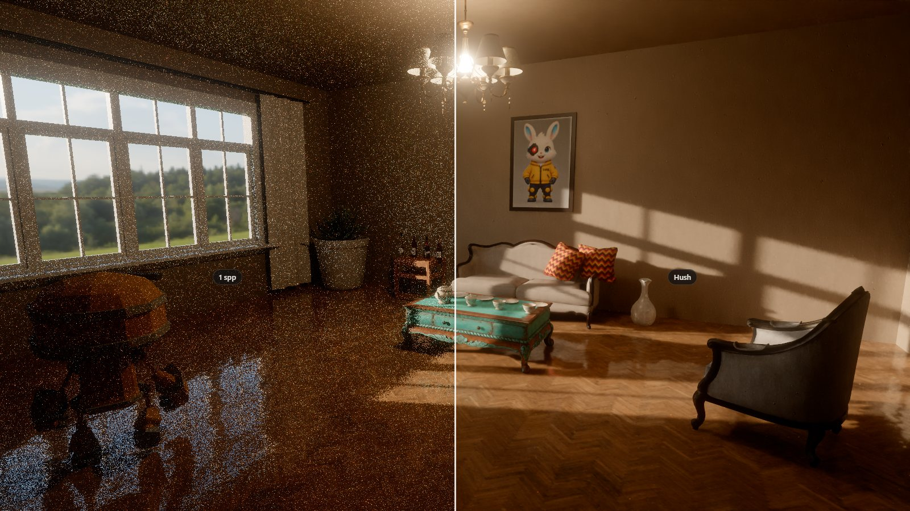
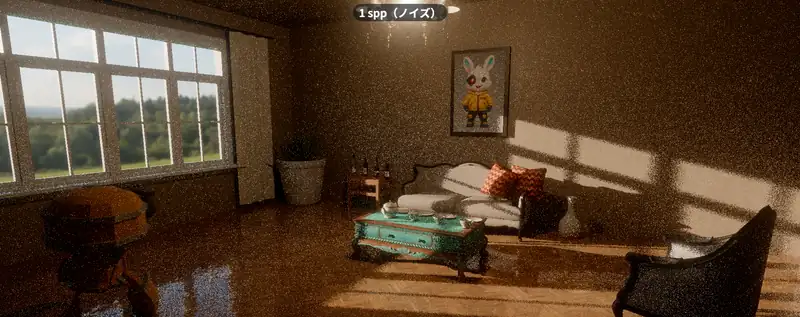
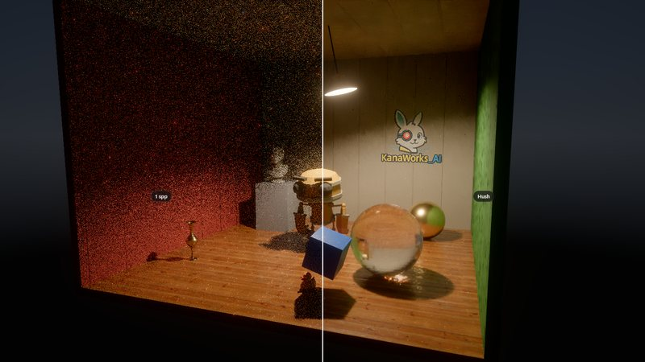
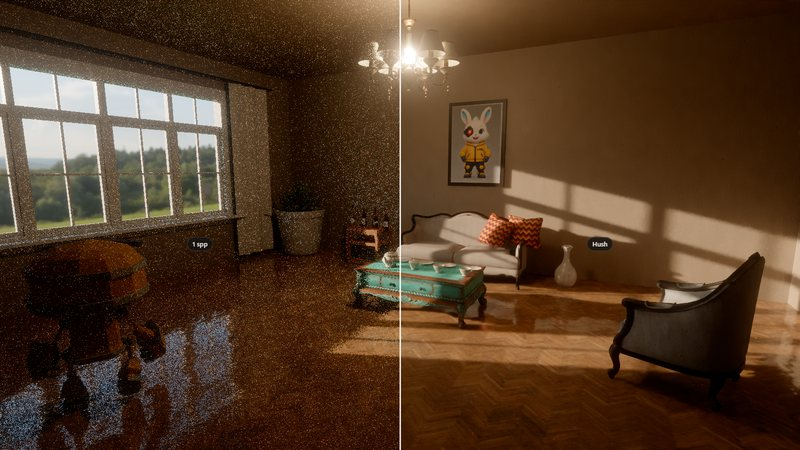
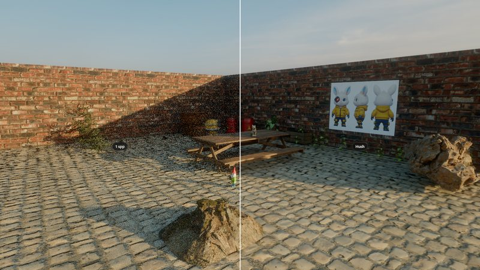

<div align="center">


<p>
  <a href="LICENSE"></a>
  
  <a href="https://threejs.org"></a>
  
  <a href="https://hush.tokyoaivisuals.club"></a>
  <a href="https://github.com/kanaworksai-hue/hush/stargazers"></a>
</p>

<p><a href="https://github.com/kanaworksai-hue"></a>&nbsp;<a href="https://github.com/kanaworksai-hue"><b>A KanaWorks_AI project</b></a></p>

**English** | [简体中文](README.zh-CN.md) | [日本語](README.ja.md)

[🖥️ Live demo](https://hush.tokyoaivisuals.club) · [three.js example](https://hush.tokyoaivisuals.club/examples/three/) · [Quick start](#-quick-start) · [API](#-api) · [Limitations](#%EF%B8%8F-limitations) · [⭐ Star](#-like-it-star-it)

</div>

**Hush** turns a noisy 1 sample-per-pixel path-traced frame into a clean, temporally stable image in real time, right in the browser. It runs as a handful of WebGPU compute passes on your own `GPUDevice`: give it the noisy frame and a G-buffer (normals, depth, albedo, motion vectors) as `GPUTexture`s, get a denoised texture back. It works with three.js `WebGPURenderer` or any other WebGPU renderer.

<p align="center">
  
  <br><sub>The same frame: 1 sample per pixel on the left, after Hush on the right.</sub>
</p>

## ✨ Highlights

<table>
<tr>
<td align="center" width="25%"><b>⚡ Real time</b><br><sub>A few compute passes per frame; the network runs at half resolution and only steers the filters</sub></td>
<td align="center" width="25%"><b>🎞️ Stable</b><br><sub>Temporal accumulation with exact motion vectors and TAA, so the image doesn't crawl or flicker</sub></td>
<td align="center" width="25%"><b>🧩 Renderer-agnostic</b><br><sub>Inputs and output are plain <code>GPUTexture</code>s; a three.js example is included</sub></td>
<td align="center" width="25%"><b>📦 Batteries included</b><br><sub>Weights are built in, plus a small path tracer for three.js scenes and an SVGF baseline</sub></td>
</tr>
</table>

<p align="center">
  
</p>

## 🧭 How it works

Hush combines SVGF-style temporal accumulation with a tiny per-pixel network that predicts the **filter parameters** (temporal blend, edge-stopping strength, detail and coarse-level weights) at half resolution, followed by edge-aware à-trous filtering and TAA. The network never outputs pixels, so on content it hasn't seen it falls back to behaving like a classic edge-aware filter instead of making things up.

| | | |
|---|---|---|
|  |  |  |

Status: research prototype. The built-in weights were trained on these three example scenes.

## 🚀 Quick start

The fastest way to see it is the **[live demo](https://hush.tokyoaivisuals.club)**: drag the divider to compare 1 spp, SVGF and Hush. It needs a browser with WebGPU (Chrome / Edge 113+, Safari 26+).

To run the demos locally (Node.js 20.19+, and Python 3 for the asset download):

```bash
git clone https://github.com/kanaworksai-hue/hush.git
cd hush
npm install
python tools/fetch_assets.py   # CC0 demo assets (Poly Haven, RobotExpressive) -> public/assets/
npm run dev                    # http://localhost:5180/                 comparison demo
                               # http://localhost:5180/examples/three/  three.js example
```

`npm run build` writes a static site to `dist/`. WebGPU only works in a secure context, so to try a local build on a phone, serve it over https (or just use the live demo).

## 🧰 API

Hush is not on npm yet (the `hush` package there is an unrelated project). Install it from GitHub; the import name is still `hush`:

```bash
npm install github:kanaworksai-hue/hush
```

```js
import { Hush } from 'hush';

// the device needs a few more storage textures than the WebGPU defaults
const adapter = await navigator.gpu.requestAdapter();
const device = await adapter.requestDevice({ requiredLimits: Hush.requiredLimits });

const hush = new Hush(device, { width, height, exposure: 1 });   // weights are built in

// every frame, after your path tracer wrote this frame's G-buffer:
const encoder = device.createCommandEncoder();
const image = hush.denoise(encoder, { radiance, normalDepth, motion, material, emission });
// ... tone map / display `image` (rgba16float, linear HDR) ...
device.queue.submit([encoder.finish()]);

hush.resize(w, h);     // new size
hush.reset();          // camera cut
hush.exposure = 2;     // display exposure
```

Inputs are `rgba16float` textures of the denoiser's size with `TEXTURE_BINDING` usage:

| texture | contents |
|---|---|
| `radiance` | noisy 1 spp radiance, without the emission of the primary hit |
| `normalDepth` | world-space normal (xyz), linear view depth (w, negative = sky) |
| `motion` | previous − current pixel position (xy, pixels), object id (z, integer < 2048), previous linear depth (w) |
| `material` | albedo (rgb), roughness (a) |
| `emission` | emission of the primary hit |

The output alternates between two textures from frame to frame (`hush.output` is the latest). An SVGF baseline with the same inputs is exported as `SVGF`. Types: [`src/index.d.ts`](src/index.d.ts), [`src/pt/index.d.ts`](src/pt/index.d.ts).

### With three.js

`WebGPURenderer` gives you the device; pass the limits when creating it:

```js
import * as THREE from 'three/webgpu';
const renderer = new THREE.WebGPURenderer({ requiredLimits: { ...Hush.requiredLimits } });
await renderer.init();
const device = renderer.backend.device;
```

[`examples/three/`](examples/three/main.js) path traces an ordinary three.js scene graph (glTF models, an HDRI as `scene.environment`, a `PointLight`) with the included path tracer (`hush/pathtracer`), denoises it with Hush and draws the result through three.js (an `ExternalTexture` per output texture on a fullscreen quad, three.js tone mapping). Drag to orbit.

The path tracer handles meshes with `MeshStandardMaterial` / `MeshPhysicalMaterial` (base colour, roughness / metalness, normal maps, emissive, smooth glass); moving or skinned objects go under a group with `userData.dynamic = true`. Lights: `scene.environment` (an equirectangular HDR texture, e.g. from `HDRLoader`; importance sampled, its sun is extracted into a sharp sun light), `DirectionalLight`, `PointLight` (`userData.radius`) and `HemisphereLight`.

## 📁 What's in this repository

```
src/index.js        Hush (built-in weights) and an SVGF baseline
src/denoise/        the WGSL compute passes and the weights
src/pt/             hush/pathtracer: a small WebGPU path tracer for three.js scene graphs
index.html          the comparison demo (src/demo/)
examples/three/     Hush in a three.js WebGPURenderer app
examples/minimal/   the API without a renderer
```

The training code is not included in this first release.

## ⚠️ Limitations

- The weights were trained on the three example scenes. On other content Hush still works, but it is not always better than SVGF; large areas of low-frequency noise (flat walls, floors lit only by the sky) are the weakest case.
- Like SVGF, it filters what the G-buffer sees: content behind glass or mirrors is blurred.
- The path tracer is a demo renderer: no next-event estimation for emissive meshes (only for sphere lights, the sun and the environment map), smooth solid glass only, and shadow rays do not pass through glass.
- Object ids are stored in f16 and must stay below 2048.

## ⭐ Like it? Star it

If Hush is useful to you, please click **⭐ Star** at the top of the [repository page](https://github.com/kanaworksai-hue/hush). It helps other people find the project, and it tells us the work is worth continuing.

Bug reports and ideas are welcome as [issues](https://github.com/kanaworksai-hue/hush/issues). Made something with it? Share it on X and tag [@KanaWorks_AI](https://x.com/KanaWorks_AI).

## 📄 License and credits

- **This project:** [MIT](LICENSE) © 東京AI映像合同会社.
- **Demo assets:** models, textures and HDRIs from [Poly Haven](https://polyhaven.com) (CC0) and RobotExpressive by Tomás Laulhé (CC0), downloaded by `tools/fetch_assets.py`, not included in the repository. Details: [`THIRD_PARTY.md`](THIRD_PARTY.md).
- **Brand:** the KanaWorks_AI name, logo and the Kana character (in `docs/brand/`, `public/brand/`, the banners and the demo scenes) are © 東京AI映像合同会社 (Tokyo AI Visuals LLC) and are **not** covered by the MIT license. See [docs/brand](docs/brand/README.md). The demo runs without them with `?brand=0`.
- **Built on:** [WebGPU](https://www.w3.org/TR/webgpu/) and [three.js](https://threejs.org). The denoiser follows published work on SVGF (Schied et al. 2017) and learned filter-parameter prediction.

<br>

<div align="center">

<a href="https://x.com/KanaWorks_AI"></a>

<p><b>Made with ♥ by <a href="https://x.com/KanaWorks_AI">KanaWorks_AI</a></b></p>

<p><sub>If Hush saves you time, a ⭐ helps others find it. More projects: <a href="https://github.com/kanaworksai-hue">github.com/kanaworksai-hue</a></sub></p>

</div>
